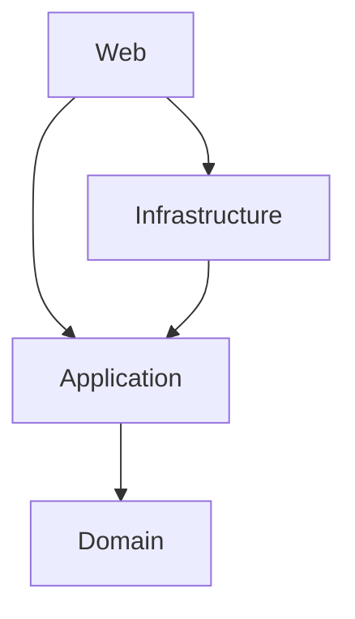

# GamesEdge

[](https://github.com/nwdorian/GamesEdge/actions/workflows/build.yml)
[](https://github.com/nwdorian/GamesEdge/actions/workflows/test-architecture.yml)
[](LICENSE)

A .NET 10 web application built with Clean Architecture principles. Provides management of a games catalogue and provides the surrounding platform: user accounts with ASP.NET Core Identity, role-based
authorization, email notifications, auditing, and soft deletes.

## Table of contents

- [GamesEdge](#gamesedge)
  - [Table of contents](#table-of-contents)
  - [Features](#features)
  - [Architecture](#architecture)
  - [Tech stack](#tech-stack)
  - [Prerequisites](#prerequisites)
  - [Getting started](#getting-started)
    - [Clone](#clone)
    - [Run with Docker (recommended)](#run-with-docker-recommended)
    - [Run without docker](#run-without-docker)
  - [Local development with docker](#local-development-with-docker)
  - [Testing](#testing)
  - [Project structure](#project-structure)
  - [Development tooling](#development-tooling)
  - [CI](#ci)
  - [Personal thoughts](#personal-thoughts)
  - [Contributing](#contributing)
  - [License](#license)
  - [Contact](#contact)

## Features

- **Clean Architecture** with `Domain`, `Application`, `Infrastructure`, and `Web` layers.
- **Games catalogue**: CRUD, paging, sorting, and filtering over the `Game` entity.
- **Application layer** with commands, queries, and response models.
- **EF Core (SQL Server)** persistence with an `ApplicationDbContext`, interceptors for
  auditable updates and soft deletes, and a `DataSeeder`.
- **ASP.NET Core Identity** (`User` / `Role`) with confirmed email sign-in, custom claims, and role policies.
- **Email notifications** via `MailKit` (SMTP), with templated messages.
- **Serilog** structured logging to console and Seq.
- **MVC presentation** with controllers and Razor views.
- **Architecture tests** that enforce layer dependency rules.

## Architecture

GamesEdge follows Clean Architecture. Dependencies point inward, and the rules are enforced by
architecture tests so the layering cannot silently drift.



| Layer | Responsibility |
| -- | -- |
| **Domain** | Entities (`Game`), core abstractions (`ISoftDeletable`, `IAuditable`, `IDateTimeProvider`), and `Result`/`Error` types. No dependency on other layers. |
| **Application** | Use cases and contracts - `GameService`, `IApplicationDbContext`, `IEmailService`, `IEmailNotificationService`, `IUserContext`, paging/sorting helpers. Depends only on Domain. |
| **Infrastructure** | EF Core `ApplicationDbContext`, SQL Server provider, migrations, interceptors, seeding, Identity stores, authorization roles/policies, time provider, user context, and SMTP email implementation. |
| **Web** | ASP.NET Core MVC host - controllers, views, models, middleware. |

## Tech stack

| Area | Technologies |
| -- | -- |
| Framework | .NET 10.0, C# 14, ASP.NET Core MVC |
| Data | EF Core 10, SQL Server |
| Auth | ASP.NET Core Identity, cookie auth |
| Email | MailKit |
| Logging | Serilog, Console and Seq sinks |
| Testing | xUnit v3 |
| Tooling | Central Package Management, IDisposableAnalyzers, SonarAnalyzer, CSharpier |
| Containers | Dockerfile, Docker Compose |

## Prerequisites

Run with Docker (recommended)

- [Docker Desktop](https://www.docker.com/products/docker-desktop/) to run the application, SQL Server, Mailpit, and Seq.

Run without Docker

- [.NET SDK 10.0](https://dotnet.microsoft.com/download/dotnet/10.0)
- [SQL Server](https://www.microsoft.com/en-us/sql-server/sql-server-downloads)
- [MailPit](https://mailpit.axllent.org/docs/install/)

## Getting started

### Clone

```bash
git clone https://github.com/nwdorian/GamesEdge.git
cd GamesEdge
```

### Run with Docker (recommended)

```bash
docker compose up -build
```

| Service | UI | Endpoint |
| -- | -- | -- |
| Web | <http://localhost:8080> | - |
| SQL Server | - | localhost:1433 |
| Mailpit | <http://localhost:8025> | localhost:1025 |
| Seq | <http://localhost:8081> | localhost:5341 |

### Run without docker

1. Update the database connection string in `src/Web/appsettings.Development.json`:

   ```json
   "ConnectionStrings": {
     "DefaultConnection": "Data Source=(localdb)\\MSSQLLocalDB; Initial Catalog=GamesEdge; Integrated Security=SSPI"
   }
   ```

2. Start the MailPit service

   - Access the email testing UI at <http://localhost:8025> to view all emails sent by the application.

3. Build and run:

   ```bash
   cd src/Web
   dotnet run
   ```

## Local development with docker

1. Start external services with development configuration

    ```bash
    docker compose -f compose.dev.yaml up --build
    ```

2. Build and run the application:

   ```bash
   cd src/Web
   dotnet run
   ```

3. Stop services

    ```bash
    docker compose down -v
    ```

## Testing

The solution currently ships architecture tests that verify the Clean Architecture dependency rules.

```bash
# Run the architecture tests
dotnet test tests/ArchitectureTests/ArchitectureTests.csproj
```

Enforced rules include:

- `Domain` must not depend on `Application`, `Infrastructure`, or `Web`.
- `Application` must not depend on `Infrastructure` or `Web`.
- `Infrastructure` must not depend on `Web`.

## Project structure

```text
GamesEdge/
├── .config/                     # Local dotnet tools (csharpier, dotnet-ef, husky)
├── .github/workflows/           # CI: build.yml, test-architecture.yml
├── .husky/                      # Husky.Net pre-commit hook + task runner
├── compose.yaml                 # Full stack (web + dependencies)
├── compose.dev.yaml             # Dependencies only
├── Directory.Build.props        # Shared build properties
├── Directory.Packages.props     # Central package management
├── GamesEdge.slnx               # Solution
├── LICENSE                      # MIT
├── src/
│   ├── Application/             # Use cases, contracts, paging, emails, notifications
│   ├── Domain/                  # Game entity, abstractions, Result/Error
│   ├── Infrastructure/          # EF Core, migrations, Identity, email, seeding
│   └── Web/                     # MVC host: Program, controllers, views, models
└── tests/
    └── ArchitectureTests/       # NetArchTest layer-boundary tests
```

## Development tooling

- **Central Package Management** - all package versions live in `Directory.Packages.props`.
- **Analyzers** - `IDisposableAnalyzers` and `SonarAnalyzer.CSharp`; the build uses
  `AnalysisLevel=latest-Recommended` with `TreatWarningsAsErrors=true`.
- **CSharpier** - enforced in CI (`dotnet csharpier check .`) and by the Husky pre-commit hook,
  which formats staged `.cs`, `.csproj`, `.props`, `.targets`, `.xml`, and `.config` files.
- **dotnet-ef** - available through `dotnet tool restore` for creating and applying migrations.

## CI

GitHub Actions run on pull requests targeting `main`:

- **Build** (`build.yml`) - restore tools, check formatting with CSharpier, restore, build.
- **Architecture Tests** (`test-architecture.yml`) - restore, build, and run the architecture tests.

## Personal thoughts

- The only issue I had in this project was when seeding data. Since game records don't have an owner in the form of UserId foreign key, populating the `CreatedBy` audit field through EF interceptor required a creation of system user. Alternative was to make the `CreatedBy` field nullable but that didn't align with data integrity rules.

## Contributing

Contributions are welcome! Please fork the repository and create a pull request with your changes. For major changes, please open an issue first to discuss what you would like to change.

## License

This project is licensed under the MIT License. See the [LICENSE](./LICENSE) file for details.

## Contact

For any questions or feedback, please open an issue.
